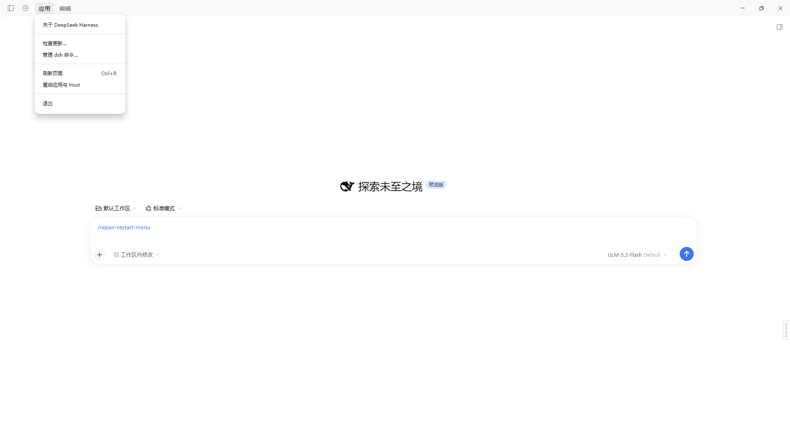

# repair-restart-menu — DeepSeek Harness "重启应用与 Host" 菜单项补丁 (Windows)

为 DeepSeek Harness 桌面版(Windows)启用官方内置但默认隐藏的 **"重启应用与 Host"** 应用菜单项(左上角"应用"菜单)。

原理:官方菜单代码里本就存在该菜单项(`app.relaunch()` + 退出),仅开发模式显示。本补丁把 `app.asar` 内 main.js 的 `...development ? [` 等长 11 字节替换为 `...true/*dev*/ ? [`,不移动任何归档偏移,不改其他逻辑。每次运行都会重新解析 asar 头并重新定位,官方更新覆盖 app.asar 后重跑即可。



## 安装(作为 DSH skill)

DSH 会扫描 `~/.dsh/skills/` 并自动监视变化,克隆即生效(新会话可见,无需重启)。skill 名来自 `SKILL.md` 的 frontmatter(`repair-restart-menu`),与克隆到的文件夹名无关:

```
git clone https://github.com/Everglow28/dsh-skill-patch-restart.git "%USERPROFILE%\.dsh\skills\repair-restart-menu"
```

之后在 DSH 会话里对 agent 说"运行 repair-restart-menu"即可;也可以完全不用 DSH,直接在终端手动执行下面的命令。

## 手动执行

需要任意 Node.js(DSH 自带的也行:
`%LOCALAPPDATA%\Programs\DeepSeek Harness\resources\runtime\primary-runtime\dependencies\node\bin\node.exe`)。

在 skill 目录下:

```powershell
# 1. 准备:定位偏移、生成补丁副本、挂起一个分离的等待进程
node dsh-restart-menu-patch.cjs prepare

# 2. 完全退出 DeepSeek Harness(托盘图标右键 → 退出),再重新打开。
#    退出瞬间等待进程自动把补丁文件换入。

# 3. 验证
node dsh-restart-menu-patch.cjs status
# live @offset …: true/*dev*/ 即生效
```

## 回滚

```powershell
node dsh-restart-menu-patch.cjs revert
```

用换入时自动保留的 `app.asar.old` 恢复;若无 `.old` 则需重装应用。确认稳定后,`app.asar.patched` 与 `app.asar.old`(~120MB each)可删。

## 适用性与注意

- 已在 DeepSeek Harness 桌面版 **0.2.0-rc.2 (ProductVersion 0.2.0.0)** 上开发并验证;其他版本未测试,但脚本不依赖固定偏移,相近版本大概率可用;
- 若新版本源码里不再有 `development` 条件,脚本会明确报 `pattern not found`,不会乱写;
- `prepare` 前建议自行备份一次 `%LOCALAPPDATA%\Programs\DeepSeek Harness\resources\app.asar`;
- 补丁会被官方更新覆盖,重新 `prepare` 一次即可。
